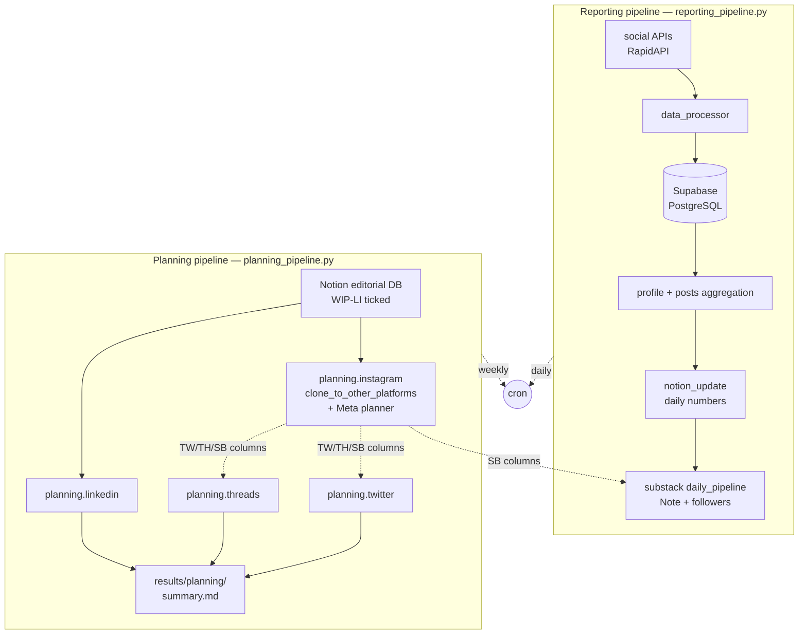
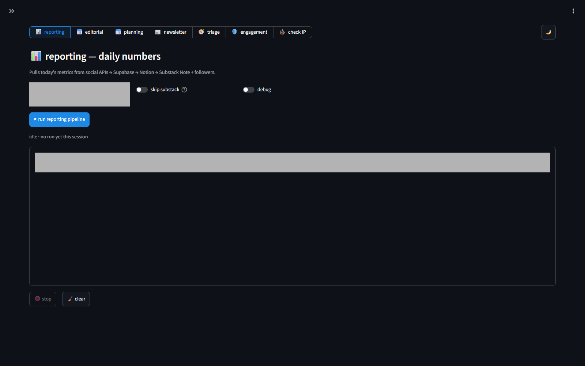
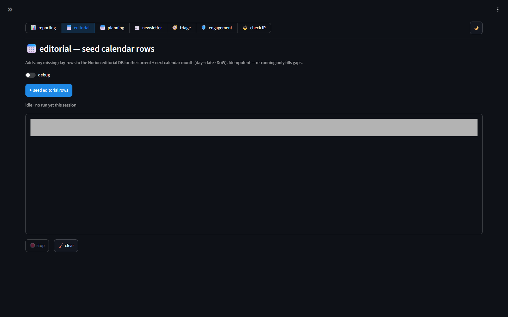
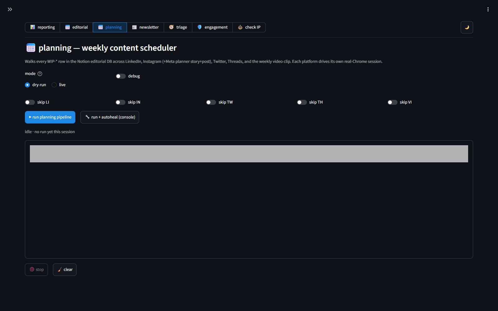
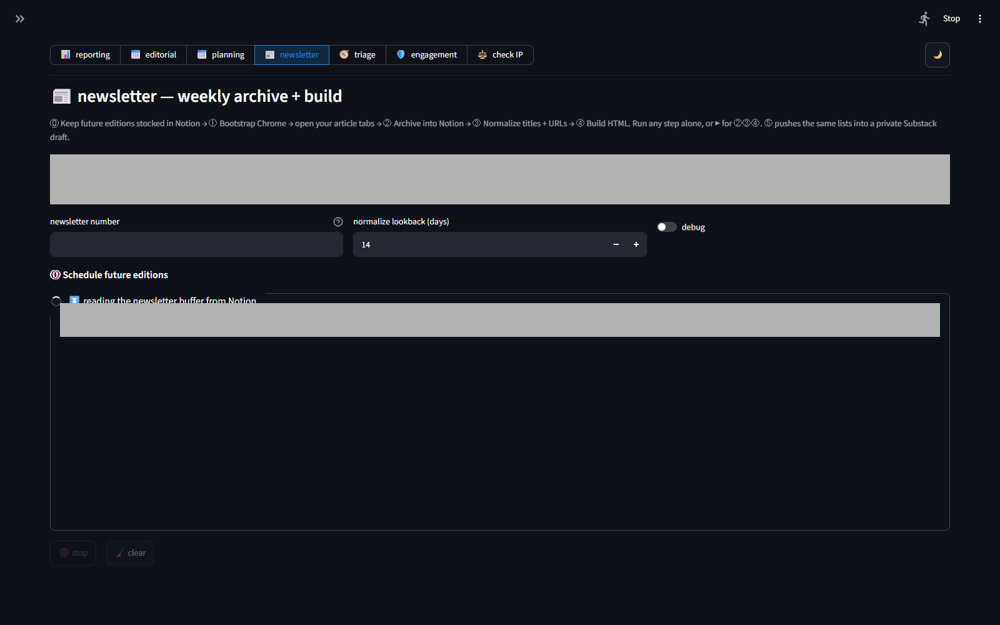
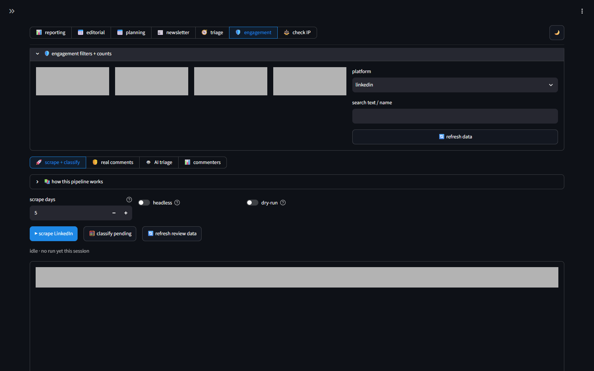
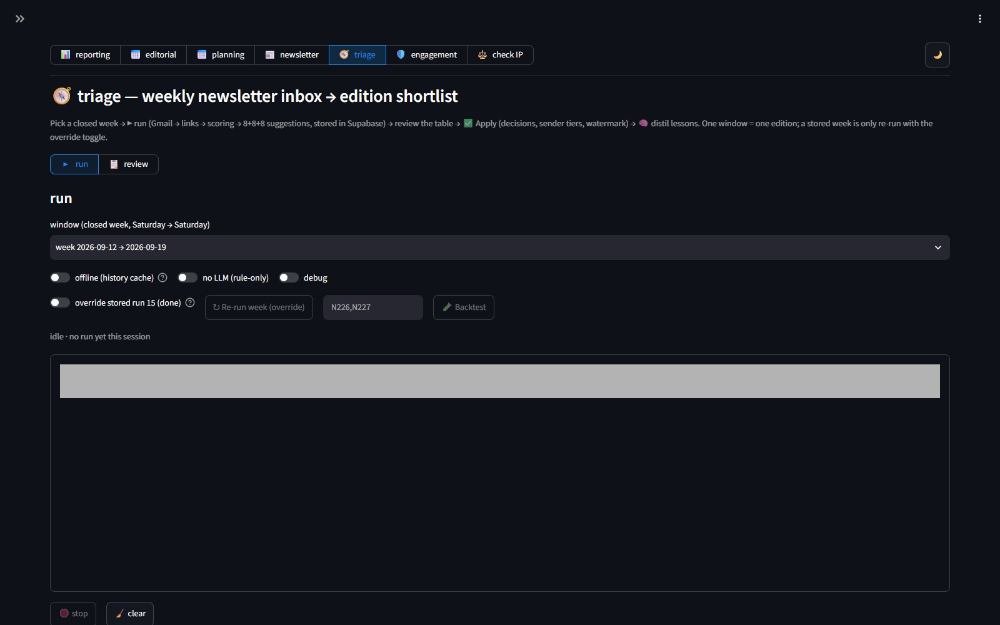
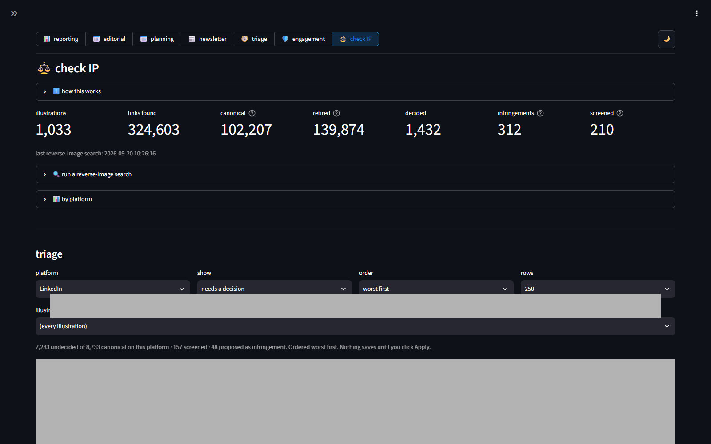
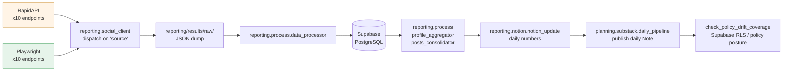

# Social Media Automation Suite

Six surfaces, one repo:

- **Reporting** (`reporting/`, `reporting_pipeline.py`) — pulls daily
  metrics from social media APIs, processes through Supabase, syncs to
  Notion, and runs the daily Substack Note.
- **Planning** (`planning/`, `planning_pipeline.py`) — schedules next
  week's (or weeks') content on LinkedIn, Instagram (+ Meta planner story
  + post), Twitter, Threads, and the weekly **video** clip (cross-platform
  LI/IG/TW/TH at 19:00 Madrid + a Substack video Note posted by the daily
  pipeline). Each platform's native scheduler is driven via real Chrome
  with a dedicated profile. The Instagram step also clones captions /
  illustrations into the TW/TH/SB Notion columns so the other planners
  and the daily Substack run can consume them.
- **Newsletter** (`newsletter/`, `newsletter_pipeline.py`) — the weekly
  newsletter workflow, split into independent non-interactive steps
  (`schedule` / `bootstrap` / `archive` / `normalize` / `build`, plus
  `create` and `all` composites) so each runs on its own from the app or
  a console. **Schedule** tops the buffer of *future* newsletter rows in
  Notion back up to eight, continuing the number sequence from the
  highest existing edition and the weekly cadence from the latest date —
  without those rows **Archive** has nowhere to file an article and stops.
  **Bootstrap** launches the dedicated newsletter Chrome on `:9222` without
  touching the everyday browser (targeted, idempotent). **Archive** walks the
  open article tabs in that CDP-attached Chrome into Notion (readability-lxml extraction → Gemini-Lite topic +
  3-line summary → author resolved against the connections DB with exact
  / fuzzy / LLM-pick-primary / `(not classified)` fallback — never
  invents → first future newsletter row with `< 8` per topic → write +
  close tab). An article the classifier can't label is never archived
  under a guessed topic: its tab stays open and the run summary counts it
  as `unclassified`. **Normalize** rewrites article titles to sentence case
  (preserving a proper-name whitelist; spaCy PERSON entities optional)
  and strips tracking query params from each URL except for video /
  tweet domains. **Build** emits the ready-to-paste HTML at
  `results/newsletter/N{NNN}.html`, opens it in the browser, and lets you
  compose the must-read line (interactively in a console, or via the
  app's picker fed by a topics sidecar). **substack-draft** (optional,
  separate step) pushes those same grouped lists into a *private*
  Substack draft edition over the native HTTP API — closing the last
  manual copy-paste. With a must-read choice it also titles the draft
  with that line and leads the body with a "one must read" section (the
  featured article, linked, plus its AI-generated summary), and trails
  the last topic with a "one book" section pulled from the Notion books
  database when one is linked to the newsletter. It never publishes. **Triage** (`newsletter/triage/`)
  sits upstream of all that: it reads the `newsletters` Gmail label for a
  closed week, scores every link against the owner's inferred criteria
  (54 weeks of ground truth, two-stage hub scoring, paywall/promo vetoes,
  caps), stores the run in Supabase and proposes an 8+8+8 shortlist that
  the owner reviews in the control panel's 🧭 triage tab — decisions feed
  sender tiers and owner-accepted criteria notes back into the engine.
- **Engagement** (`engagement/`) — defends comment threads against
  AI-generated noise using a layered classifier (rules → local sklearn
  model → LLM fallback via the local hub). Scrapes LinkedIn comments
  from recent posts in the Notion editorial DB, classifies them, and
  surfaces a real-comments inbox and an AI-triage queue in a Streamlit
  review app (`engagement/review_app.py`). Approved replies are staged
  for manual copy-paste — never auto-sent. See
  [`engagement/README.md`](engagement/README.md) for the full design.
- **Check IP** (`check_ip/`) — finds where my published illustrations are
  being reused. Each illustration is reverse-image-searched through Google
  Lens (SerpAPI) and every **exact** match lands in a local SQLite store —
  Lens's "similar" matches are another artist working in the same idiom, not
  reuse, so they are no longer searched for, queued or shown (and the ones
  already stored are retired, never deleted). The
  control panel's ⚖️ check IP tab is where a match gets judged —
  legitimate share, or a breach of the licence — and the
  `/check-ip` skill does the browser pass first, proposing a verdict and a
  reason for each link. The illustrations are published under **CC BY-NC-ND
  4.0**, so a post is judged on all three conditions separately: it must
  **credit me** (a visible watermark on its own is not enough), must not be
  **commercial**, and must not **modify** the image. Each condition is met,
  violated, or **not assessed** — and not assessed is never counted as a
  pass. `/check-ip <N>` fans
  the work out to Sonnet workers in batches of ten, run strictly one at a
  time — there is one browser and one LinkedIn account, and parallel
  browsing risks it. The skill **only proposes**: it never contacts anyone,
  never files a report, and cannot write the verdict. See
  [`check_ip/README.md`](check_ip/README.md).

- **Podcast** (`podcast/`, `podcast_pipeline.py`) — turns a raw two-track
  interview recording into the episode package, locally: a cleaned
  transcript (whisper per track, with a mic-bleed gate and loop repair),
  15 clips in 1:1 and 9:16 with word-timed captions in the house style
  (LLM-reviewed in context), jump cuts over pauses and fillers and a 1:1
  crop that follows the speaker,
  a title, LinkedIn post and Instagram caption per clip, covers, the
  episode document and the website page. Each stage resumes from what is
  on disk, and a cost table plus a per-clip quality score come with every
  run. The control panel's 🎙️ podcast tab runs it and holds the owner's
  per-clip review: approve, drop, or send feedback that the `revise` stage
  applies and re-renders; covers and the package wait for that review.
  It never publishes and only reads Notion. The `/podcast` skill drives one
  episode with the owner, review included, and stops at a manual publishing
  checklist; it can re-run an episode edited by hand in a separate trial
  folder. Start to finish, one episode:
  [`docs/podcast-runbook.md`](docs/podcast-runbook.md); module reference:
  [`podcast/README.md`](podcast/README.md). The recorder (`recorder/`,
  `recorder_server.py`) holds the interview's peer-to-peer video call and
  records each side in the browser, uploading into the episode folder,
  replacing Riverside for that job: [`recorder/README.md`](recorder/README.md).

- **Demo videos** (`demo_video/`, `demo_video_pipeline.py`) — turns screen
  recordings of an app plus music into an animated product demo video
  (16:9, 1:1 or 4:5) from one `demo.json` storyboard, rendered through a
  data-driven Remotion template: a new video is new data, not new code.
  It records a disposable instance of the app through a throwaway driver,
  measures, checks (overrun, privacy, licence — a hard stop) and verifies
  every render; it never publishes. The `/demo-video` skill drives one demo
  with the owner, from the message brief to the MP4s; the control panel's
  🎬 demo video section shows the runbook and runs the deterministic
  stages. Start to finish: [`docs/demo-video-runbook.md`](docs/demo-video-runbook.md);
  module reference: [`demo_video/README.md`](demo_video/README.md).

The four content pipelines read from the same Notion editorial database;
check IP is independent of Notion and keeps its own local store. Each per-folder
README has its own mermaid flowchart, CLI table, gotchas, and validated
selector list — this README is the orientation map.



## Supported platforms

LinkedIn · Instagram · Twitter/X · Threads · Substack (Note posting, follower
count and note engagement — all three with a browser-free path over Substack's
own HTTP API). All five have a Notion editorial column set; four have a
native-scheduler driver under `planning/`.

## Project structure

[`docs/layout.md`](docs/layout.md) says what each root folder and subpackage holds and why the tool folders are declared roots.

```
content-management/                   # repo root
├── planning/                         # weekly publishing — drives platform schedulers
│   ├── linkedin/                     # LinkedIn weekly post scheduler
│   ├── instagram/                    # Meta planner (story + post) + IG→TW/TH/SB clone step
│   ├── twitter/                      # X /home composer scheduler
│   ├── threads/                      # threads.com composer + calendar scheduler
│   ├── substack/                     # Substack Note publisher + followers scraper
│   │                                 # (with a video-day branch for the weekly clip)
│   └── videos/                       # weekly cross-platform video orchestrator
├── reporting/                        # daily numbers — APIs → Supabase → Notion
│   ├── social_client/                # RapidAPI fetchers
│   ├── process/                      # transform, upload to Supabase, aggregate
│   └── notion/                       # editorial helpers + Notion sync
├── newsletter/                       # weekly newsletter pipeline (archive + normalize + build)
│                                     # archive=chrome tabs → notion; normalize_names + normalize_url
│                                     # rewrite titles + clean URLs; build_newsletter renders HTML
│                                     # substack_draft pushes the same lists to a private Substack draft
│   └── triage/                       # Gmail inbox → edition shortlist (criteria, engine, Supabase store, review, lessons)
├── engagement/                       # anti-AI comment triage (rules → sklearn → LLM fallback)
│   ├── linkedin/                     # LinkedIn comment scraper
│   ├── classify/                     # layered classifier + phrase config
│   ├── reputation/                   # per-commenter reputation feedback loop
│   └── db/                           # Supabase schema (commenters + comments tables)
├── check_ip/                         # illustration copyright check (Google Lens → SQLite → triage tab)
├── podcast/                          # episode package: transcript → clips (1:1 + 9:16) → copy, covers, docx, website HTML
├── demo_video/                       # demo videos: demo.json storyboard → Remotion template (remotion/) → MP4 per cut
├── recorder/                         # self-hosted two-side recorder: page + chunk upload into the episode folder
├── app/                              # Streamlit control panel (tabs: reporting/editorial/planning/newsletter/triage/engagement/check-IP/podcast/demo-video)
├── config/                           # config.json, mapping.json, logger_config, chrome_launch, console
│   └── doc_capture/                  # deterministic control-panel screenshot engine (README tour)
├── gmail_readonly/                   # portable, read-only Gmail OAuth + search component (vendored)
├── google_oauth_common/              # shared installed-app OAuth bootstrap for the portable Google packages (vendored)
├── results/                          # outputs — planning summaries + raw API JSON
├── logs/                             # per-module .log files
├── docs/                             # durable topic reference docs (tracked)
│   └── screenshots/                  # manifest.json + generated per-tab screenshots (tracked)
├── tests/                            # unittest + pytest-style suite — see Verification below
├── planning_pipeline.py              # orchestrator: LI → IG → TW → TH (--all-wip)
├── reporting_pipeline.py             # orchestrator: APIs → Supabase → Notion → Substack
├── newsletter_pipeline.py            # orchestrator: schedule/bootstrap/archive/normalize/build subcommands
├── podcast_pipeline.py               # orchestrator: one episode folder → its podcast package (resumable stages)
├── demo_video_pipeline.py            # orchestrator: one demo folder → its cuts (record, prep, check, render; --preview, --status)
├── recorder_server.py                # serves the recorder for one episode (host + guest links)
├── launch_app.bat                    # Streamlit control panel launcher (Windows CMD)
├── launch_planning.bat               # planning launcher (Windows CMD)
├── launch_reporting.bat              # reporting launcher (Windows CMD)
├── launch_newsletter.bat             # newsletter launcher (Windows CMD)
└── launch_autoheal.bat               # self-healing planning run (visible console)
```

### Per-folder READMEs

Each folder has a README with a consistent shape: workflow mermaid, CLI table,
Notion field map (where relevant), validated selectors (planning packages),
gotchas, files.

- **Planning** —
  [`planning/linkedin/README.md`](planning/linkedin/README.md) ·
  [`planning/instagram/README.md`](planning/instagram/README.md) ·
  [`planning/twitter/README.md`](planning/twitter/README.md) ·
  [`planning/threads/README.md`](planning/threads/README.md) ·
  [`planning/substack/README.md`](planning/substack/README.md) ·
  [`planning/videos/README.md`](planning/videos/README.md)
- **Reporting** —
  [`reporting/social_client/README.md`](reporting/social_client/README.md) ·
  [`reporting/process/README.md`](reporting/process/README.md) ·
  [`reporting/notion/README.md`](reporting/notion/README.md)
- **Newsletter** —
  [`newsletter/README.md`](newsletter/README.md)
- **Engagement** —
  [`engagement/README.md`](engagement/README.md)
- **Check IP** —
  [`check_ip/README.md`](check_ip/README.md)
- **Podcast** —
  [`docs/podcast-runbook.md`](docs/podcast-runbook.md) ·
  [`podcast/README.md`](podcast/README.md) ·
  [`recorder/README.md`](recorder/README.md)
- **Demo videos** —
  [`docs/demo-video-runbook.md`](docs/demo-video-runbook.md) ·
  [`demo_video/README.md`](demo_video/README.md) ·
  [`docs/demo-video-driver-playbook.md`](docs/demo-video-driver-playbook.md)
- **Shared** — [`config/README.md`](config/README.md)

## The launchers

The launchers are the user entrypoints. They wrap the pipeline orchestrators
and the control-panel app with the venv interpreter and keep the CMD window
open at the end so you can inspect the output.

| Launcher                  | Pipeline / app         | Default mode  | Cron-friendly arg |
|---------------------------|------------------------|---------------|-------------------|
| `launch_reporting.bat`    | Reporting              | interactive   | `auto`            |
| `launch_planning.bat`     | Planning               | dry-run       | `live`, `auto`    |
| `launch_newsletter.bat`   | Newsletter             | interactive   | n/a (interactive) |
| `launch_app.bat`          | Streamlit control panel | —            | n/a               |
| `launch_autoheal.bat`     | Planning (self-heal)   | visible console | n/a             |

```powershell
# One-shot, daily numbers pipeline (today's date, no prompts)
.\launch_reporting.bat auto

# Walk every WIP planning row across LI → IG → TW → TH (LIVE), no pause at end
.\launch_planning.bat live auto
```

Every launcher **propagates its pipeline's exit code**, so a scheduler records a
crashed run as failed rather than green. A missing or broken `.venv` is a hard
stop with a non-zero exit — never a silent fallback to a system Python, which
would run against unpinned dependencies. `tests/test_launcher_exit_codes.py`
enforces both, plus the CRLF line endings `cmd` needs to execute a `.bat`
correctly.

## 🖼️ Control panel tour

Generated, masked screenshots of each control-panel section — captured by the
doc-capture engine (see [Regenerating the screenshots](#regenerating-the-screenshots)).
Volatile / sensitive regions (live logs, metrics, dates) are grayed out by design.

<!-- docs-shots:start -->

### 📊 Reporting

Daily-numbers pipeline: pulls the day's metrics from the social APIs into Supabase, syncs Notion, and posts the Substack followers Note. Date picker, skip-Substack and debug toggles, and the live streamed log panel.



### 📅 Editorial

Seeds the Notion editorial calendar: adds any missing day-rows (day · date · DoW) for the current + next calendar month. Idempotent — re-running only fills gaps.



### 📅 Planning

Weekly content scheduler: walks every WIP-* row in the Notion editorial DB across LinkedIn, Instagram (story + post), Twitter, Threads and the weekly video clip — dry-run or live, with per-platform skip toggles.



### 📰 Newsletter

Weekly newsletter pipeline: bootstrap the dedicated Chrome, archive the open article tabs into Notion, normalize author names + URLs, and build the HTML issue — each step runnable alone or chained.



### 🛡️ Engagement

LinkedIn comment triage: scrape the comments on your recent posts, classify each as human / AI / unknown, and review the queues — canned acknowledgements are staged for copy-paste, never auto-sent.



### 🧭 Triage

Weekly newsletter inbox → edition shortlist: pick a closed Saturday→Saturday week, run the triage engine (Gmail → links → two-stage scoring → 8+8+8 suggestions stored in Supabase) with the live log, then review the editable table — tick / untick / promote, ⭐ / 🏆, notes — and Apply to persist decisions, learn sender tiers and advance the watermark. A review comment can be distilled into criteria notes you accept one by one. A stored week can be re-scored from its stored links with a chosen Stage A engine (Jev deciding with a Claude Haiku shadow by default, Jev alone, or Claude Haiku) without fetching Gmail again; your decisions and review comment survive. Stage A's engine switch (`legacy` / `jev` / `both` / the recommended `jev+legacy` shadow modes) and the `jev_pilot` replay CLI are documented in [`newsletter/README.md`](newsletter/README.md#weekly-engine-step-24-issue-211).



### ⚖️ Check IP

Illustration copyright check: reverse-image-search results for every published illustration, ranked most-reused first. Shows what the /check-ip skill proposed for each link, and the verdict plus follow-up trail the owner sets and saves with Apply. Platform, status and illustration filters; the cost-gated search run sits behind its own expander.



<!-- docs-shots:end -->

## Planning pipeline — overview

```mermaid
flowchart LR
    A[Notion editorial DB<br/>WIP-* checkboxes] --> B[planning_pipeline.py<br/>--all-wip]
    B --> L[planning.linkedin<br/>schedule_linkedin_posts]
    L --> I[planning.instagram<br/>schedule_instagram_posts<br/>story + post]
    I --> T[planning.twitter<br/>schedule_twitter_posts]
    T --> H[planning.threads<br/>schedule_threads_posts]
    H --> V[planning.videos<br/>schedule_videos_posts<br/>LI+IG+TW+TH at 19:00]
    V --> S[results/planning/<br/>YYYY-MM-DD-summary.md]
    S --> R[stdout + on-disk report]
```



The weekly **video** package shares one Notion clip page across all four
scheduled platforms (LI/IG/TW/TH) plus the daily Substack pipeline's video-day
branch, and demonstrates three patterns now reused by the LinkedIn POST +
CAROUSEL routes as well: reading post body text from a single Notion `code`
block (caching the result into a `textLI` rich_text property, chunked across
≤2000-char segments for posts that exceed Notion's per-segment limit),
resolving `@FirstName Last` mentions through LinkedIn's typeahead dropdown,
and waiting for LinkedIn's background media upload (video or document/PDF)
to settle after the composer closes. The shared helpers live in
[`planning/linkedin/linkedin_composer.py`](planning/linkedin/linkedin_composer.py).
See [`planning/videos/README.md`](planning/videos/README.md) and the
*"Reading post body text from Notion"*, *"Resolving @mentions"*, *"Waiting
for the post-Schedule upload-complete signal"* sections in
[`planning/linkedin/README.md`](planning/linkedin/README.md) for the
canonical write-ups.

The LinkedIn scheduler dispatches three routes off each WIP-LI row's
Notion relation pattern (no read of a `type` property required):
illustration-only (ILL), illustration + article + post body (POST), and
post-only with a PDF located by fuzzy folder match (CAROUSEL). Newsletter
rows are skipped (separate manual process). Full table + selectors in
[`planning/linkedin/README.md`](planning/linkedin/README.md).

- Each platform is run with `--all-wip` — no date filter, so you can plan
  one, two, or three weeks in a single run.
- **Continue-on-error across platforms** — a LinkedIn failure does not
  stop IG / TW / TH. Every failure is captured in the final markdown
  summary.
- On a successful LIVE schedule for a row, the corresponding
  `Work in Progress <P>` checkbox is unticked in Notion so re-runs are
  idempotent no-ops.
- Each platform package owns its own dedicated Chrome profile under
  `planning/<P>/chrome_user_data/` (gitignored). One-time bootstrap per
  platform: `python -m planning.<P>.bootstrap_session`.

### Self-healing planning runs

The schedulers drive live platform UIs whose DOM drifts almost weekly, silently
breaking selectors. The **🔧 run + autoheal** button in the control-panel app's
planning tab (and `launch_autoheal.bat`) runs the `/schedule-autoheal` skill in a
**visible console**: it runs the scheduler and, on a UI-drift failure, probes the
live DOM, applies a selector-only fix, re-validates with a dry-run, and — when
confident — files an issue, opens a PR, and merges end-to-end. Login / data
errors instead ping Telegram and stop for a human. The run also writes a
machine-readable `results/planning/latest-result.json`. See
[`docs/self-healing-scheduler.md`](docs/self-healing-scheduler.md) for the full
loop, failure classification, and guardrails.

## Reporting pipeline — overview



- Idempotent upserts: re-running for the same date is a no-op.
- All seven steps run as one script (`reporting_pipeline.py`). Steps 1-6 have
  per-step `--skip-*` flags for partial reruns; step 7 (the Supabase RLS /
  policy-drift posture check) always runs — read-only and
  independent of the daily data, so it has no `--skip-*` flag.
- Each of the 10 `<platform>_<data_type>` endpoints in `config/config.json`
  carries a `"source"` key picking which collector runs — `"rapidapi"`
  (paid HTTP fetcher), `"playwright"` (free logged-in-Chrome scraper), or
  `"native"` (the platform's own HTTP API with cookie auth — Substack only).
  See [`docs/data-source-selection.md`](docs/data-source-selection.md)
  for how to flip per platform and roll back.
- **Fails loudly when it drops data.** The run sends **one** Telegram alert and
  exits non-zero if any of these hold: a step raised; a configured endpoint
  produced no raw file for the date; or — after consolidation — a platform has
  **no post metrics** in the consolidated `posts` row for the day (a
  content-level check, since a raw file can exist yet contain no post the
  consolidator can match). The alert lists the date + failing steps + missing
  endpoints + platforms with no post metrics. A clean run sends nothing and
  exits `0`. The alert is routed by intent — `--category attention`, resolved to a
  chat by the fleet's `hooks/projects.toml`, so no chat id lives in this repo —
  and delivered by the fleet-wide `~/.claude/hooks/notify_send.py` bot helper.

## Quick Start

### Prerequisites

- Python 3.11+ (tested on 3.14)
- PostgreSQL database (local or Supabase cloud)
- API keys for social media platforms (via RapidAPI)
- Notion API token
- Real Chrome (used by planning Playwright drivers, channel="chrome")

### Installation

```powershell
git clone <repository-url>
cd content-management

# Create venv and install
python -m venv .venv
& .\.venv\Scripts\python.exe -m pip install -r requirements.txt

# Configure
Copy-Item config\config_example.json config\config.json
# edit config\config.json with API keys, Notion token, Supabase URL/key
# PostgreSQL connection credentials go in .env instead (read by python-dotenv)

# One-time per-platform browser session bootstrap (interactive login):
& .\.venv\Scripts\python.exe -m planning.linkedin.bootstrap_session
& .\.venv\Scripts\python.exe -m planning.instagram.bootstrap_session
& .\.venv\Scripts\python.exe -m planning.twitter.bootstrap_session
& .\.venv\Scripts\python.exe -m planning.threads.bootstrap_session
& .\.venv\Scripts\python.exe -m planning.substack.bootstrap_session
# planning.videos reuses the four sister sessions above — no separate bootstrap.
```

### Daily reporting run

```powershell
.\launch_reporting.bat auto
# OR per-step:
& .\.venv\Scripts\python.exe reporting_pipeline.py --date 20260517 --yes
& .\.venv\Scripts\python.exe reporting_pipeline.py --date 20260517 --yes --skip-substack
```

Each reporting endpoint in `config/config.json` picks its data source
(RapidAPI, Playwright or — Substack-only — a native HTTP API) via a
per-endpoint `"source"` key; flipping, trade-offs, rollback and cancelling
the RapidAPI subscription are covered in
[`docs/data-source-selection.md`](docs/data-source-selection.md).

### Weekly planning run

```powershell
# After filling the Notion IG side and ticking WIP-IG / WIP-LI for next week:
.\launch_planning.bat live auto
# Dry-run rehearsal (no posts scheduled):
.\launch_planning.bat
```

## 📊 Data Schema

The Supabase (PostgreSQL) schema — raw per-platform tables, the consolidated
daily `profile` / `posts` aggregates, and the Notion sync tables (columns,
type mapping, the 15+ synced databases) — is documented in
[`docs/data-schema.md`](docs/data-schema.md) rather than here, so this
orientation map stays short. See that file for column-level detail.

## 🐛 Debug Commands

```powershell
# Test database connection (also verifies RLS/policy posture)
& .\.venv\Scripts\python.exe -m reporting.process.supabase_policy_script --check

# Analyze Notion database structure
& .\.venv\Scripts\python.exe -m reporting.notion.notion_database_structure --debug

# Process single platform
& .\.venv\Scripts\python.exe -m reporting.social_client.social_api_client --platform linkedin_profile --debug

# Smoke-test one planning scheduler (dry-run, no posts written)
& .\.venv\Scripts\python.exe -m planning.twitter.schedule_twitter_posts --all-wip --dry-run --debug
```

## 🖼️ Regenerating the screenshots

The [Control panel tour](#-control-panel-tour) section is generated by
`config/doc_capture` from `docs/screenshots/manifest.json` (the contract:
description, source globs, navigation, **required** mask selectors per tab).

```powershell
# app must be running (launch_app.bat), then:
& .\.venv\Scripts\python.exe -m config.doc_capture all          # capture stale tabs + regen README
& .\.venv\Scripts\python.exe -m config.doc_capture all --force  # recapture everything
```

Idempotent by input hash — a rerun with unchanged `app/tab_*.py` sources
captures nothing and leaves the README untouched. Hard safety invariant: a
manifest entry without `mask` selectors is refused (skipped with a warning),
never captured raw. See [Verification](#-verification) below for the test
suite command.

## ✅ Verification

No CI pipeline — run the test suite locally before shipping. Most of `tests/`
is `unittest.TestCase`-based and picked up by discovery:

```powershell
& .\.venv\Scripts\python.exe -m unittest discover tests -v
```

`tests/test_gmail_readonly.py` is pytest-style (plain test functions, not
`unittest.TestCase`) — `unittest discover` silently skips it, no error, no
warning. Run it separately with pytest, or run the whole suite through pytest
instead, which understands both styles:

```powershell
& .\.venv\Scripts\python.exe -m pytest tests/test_gmail_readonly.py -v
# or, to cover everything (unittest- and pytest-style) in one pass:
& .\.venv\Scripts\python.exe -m pytest tests -v
```

`tests/test_no_uncalled_functions.py` fails on any function or method whose name
appears nowhere else in the tracked files, so dead code cannot land unnoticed.

The gate's second stage is the static-analysis ratchet. It compares the repo's
unused imports, unused variables and duplicated blocks with the committed
baseline (`.static-ratchet-baseline.json`) and fails on any **new** one, so the
debt can only shrink. It needs Node (`npx` runs `jscpd`; the first run downloads
it) and `ruff` in the venv (`pip install -r requirements.txt`). Run it through
the wrapper, which reports a detector that could not run as **NOT CONFIRMED**
(a failure, never a pass or a skip):

```powershell
& .\.venv\Scripts\python.exe -m scripts.static_ratchet_gate
```

After removing baselined debt, shrink the baseline in the same PR with
`& .\.venv\Scripts\python.exe scripts/static_ratchet.py --update-baseline`.
`gmail_readonly/` and `google_oauth_common/` are excluded: they are vendored
copies. See the scaffold's `docs/static-ratchet.md` for the exit codes and keys.

The third stage is the docs ratchet. It fails when `README.md` grows past 40 KiB
or past its baselined size, or when `README.md` or a `docs/**/*.md` file gains a
history marker (an issue reference, a dated heading or a changelog heading) above
its count in `.docs-ratchet-baseline.json`. Docs state what is true and why, in
the present tense; history lives in git, PRs and issues. The wrapper reports a
doc it could not read as **NOT CONFIRMED** (a failure, never a pass or a skip):

```powershell
& .\.venv\Scripts\python.exe -m scripts.docs_ratchet_gate
```

After rewording a marker away, shrink the baseline in the same PR with
`& .\.venv\Scripts\python.exe scripts/docs_ratchet.py --update-baseline`. See the
scaffold's `docs/docs-ratchet.md` for the exit codes and keys.

The fourth stage is the comment ratchet. It counts `#NNN` issue references
inside product-code comments per file (a comment states the present-tense why;
history lives in git, PRs and issues) and fails when a file's count rises above
`.comment-ratchet-baseline.json`. The wrapper reports a file it could not scan
as **NOT CONFIRMED** (a failure, never a pass or a skip):

```powershell
& .\.venv\Scripts\python.exe -m scripts.comment_ratchet_gate
```

After rewording a reference away, shrink the baseline in the same PR with
`& .\.venv\Scripts\python.exe scripts/comment_ratchet.py --update-baseline`.
`gmail_readonly/` and `google_oauth_common/` are excluded: they are vendored
copies. See the scaffold's `docs/comment-ratchet.md` for the exit codes and keys.

The fifth stage is the structure ratchet. It fails when a file passes 1,000 lines,
a function 100 lines or a directory 40 modules and is new or above its size in
`.structure-ratchet-baseline.json`, or when the tracked root folders stop matching
`shape` and `extra_roots` in `.fleet.toml`. The wrapper reports something it could
not measure as **NOT CONFIRMED** (a failure, never a pass or a skip):

```powershell
& .\.venv\Scripts\python.exe -m scripts.structure_ratchet_gate
```

After splitting a baselined file or function, shrink the baseline in the same PR with
`& .\.venv\Scripts\python.exe scripts/structure_ratchet.py --update-baseline`; only
`--allow-additions` adds an entry. `gmail_readonly/` and `google_oauth_common/` are
excluded: they are vendored copies. See the scaffold's `docs/structure-ratchet.md`
for the exit codes and keys.

## 📝 License and contact

This project is free software for personal use from Roberto Ferraro 😇

https://www.linkedin.com/in/ferraroroberto/

Built with ❤️ for automated social media analytics and reporting
